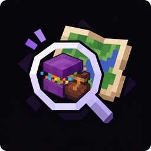
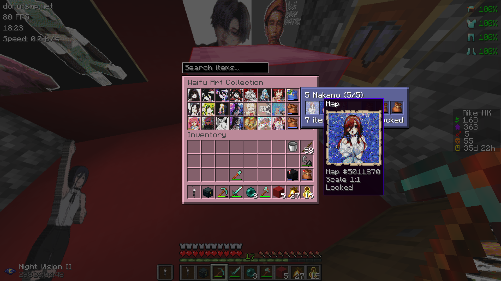
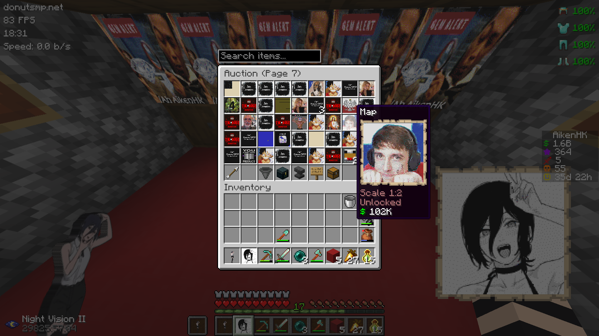
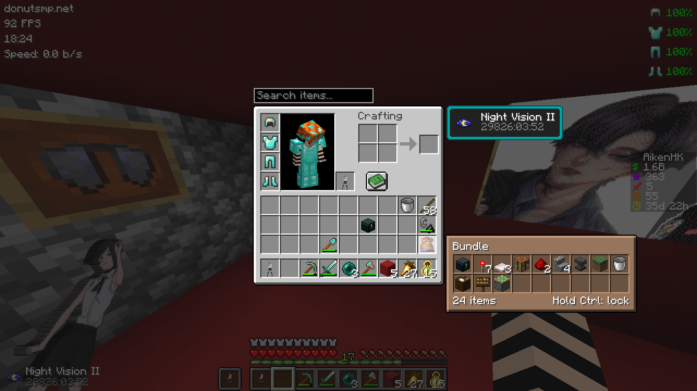
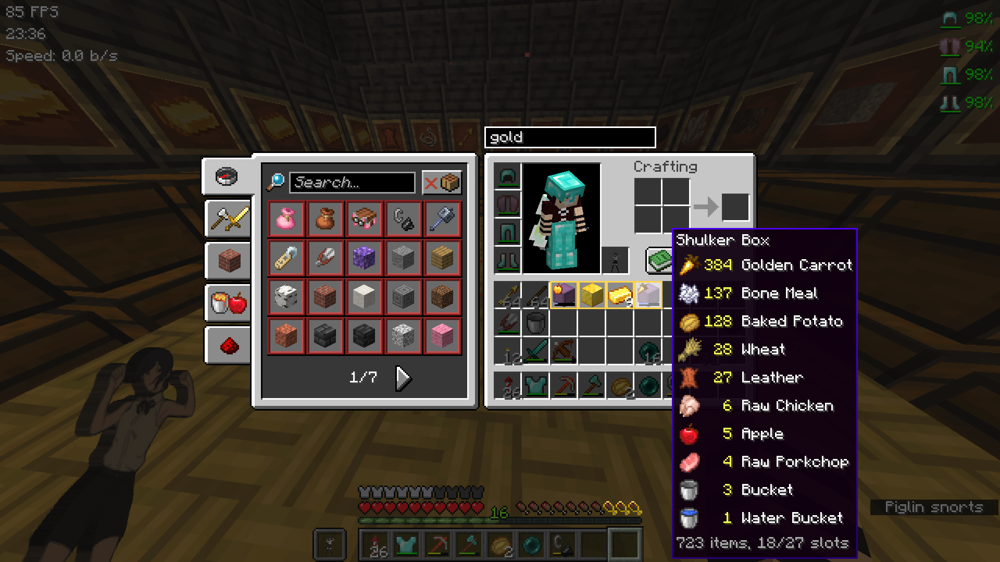
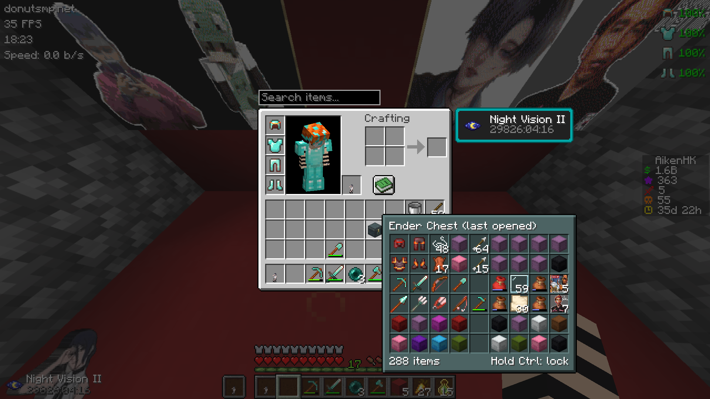
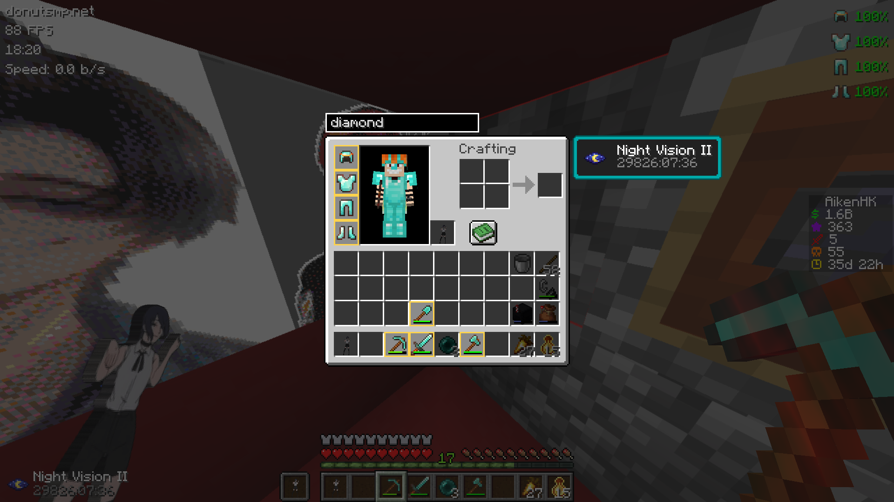

<p align="center">
  
</p>

<h1 align="center">Universal Viewer</h1>

<p align="center">
  Lihat isi map, shulker box, dan bundle tanpa membukanya, untuk Horizon (Minecraft Java 26.3 versi Rust).<br>
  Sepenuhnya di sisi client, jadi jalan di server mana pun, termasuk server vanilla.
</p>

## Preview

<table>
  <tr>
    <td width="50%"><br><sub>Gambar map di slot chest dan tooltip map, lengkap dengan ID, skala, dan status lock.</sub></td>
    <td width="50%"><br><sub>Tooltip map di menu server; baris dari server, seperti harga, tetap tampil.</sub></td>
  </tr>
  <tr>
    <td width="50%"><br><sub>Tahan Shift untuk melihat isi shulker box atau bundle sebagai grid.</sub></td>
    <td width="50%"><br><sub>Tahan Alt untuk melihat isinya sebagai daftar, dari item yang paling banyak.</sub></td>
  </tr>
  <tr>
    <td width="50%"><br><sub>Isi ender chest terakhir kali dibuka, dilihat dari item ender chest.</sub></td>
    <td width="50%"><br><sub>Kotak cari: slot yang cocok diberi garis, sisanya digelapkan.</sub></td>
  </tr>
</table>

## Fitur

- **Gambar map di slot**: map yang sudah termuat menampilkan gambarnya sendiri sebagai ikon, penuh tanpa bingkai,
  di inventory, chest, ender chest, dan hotbar.
- **Tooltip map**: hover map untuk melihatnya lebih besar di tooltip vanilla, di dalam bingkai map asli game, lengkap
  dengan **ID**, **skala** (1:1 sampai 1:16), dan status **Locked/Unlocked**. Ukuran gambarnya bisa dipilih 64, 96,
  atau 128 px (bawaan) di Options > Mods > Universal Viewer.
- **Isi shulker box dan bundle**: tahan **Shift** sambil hover untuk melihat seluruh isinya dalam grid bergaya
  inventory vanilla, berwarna sesuai warna shulker atau bundle-nya (16 warna dye plus versi polos).
- **Daftar isi (Alt)**: tahan **Alt** sambil hover shulker box atau bundle untuk melihat isinya sebagai daftar:
  satu baris per jenis item dengan ikon dan jumlah totalnya, dari yang paling banyak, ditambah total item dan slot
  yang terpakai.
- **Tanda di slot**: shulker box menampilkan bar seberapa penuh isinya di bawah ikonnya, dan shulker box maupun
  bundle menampilkan ikon kecil item yang paling banyak di dalamnya di pojok kiri atas. Bisa diatur (keduanya, bar
  saja, ikon saja, atau mati) di Options > Mods > Universal Viewer.
- **Ingatan ender chest**: setiap kali ender chest dibuka, isinya diingat. Setelah itu, hover item ender chest sambil
  tahan **Shift** (grid) atau **Alt** (daftar) untuk melihat isinya terakhir kali dibuka, per server atau per world.
  Ingatan hanya disimpan selama game berjalan, tidak ditulis ke disk.
- **Kotak cari**: di atas layar inventory dan container ada kotak **Search items...**. Ketik nama item, maka slot yang
  berisi item itu, termasuk shulker box, bundle, dan ender chest yang isinya mengandung item tersebut, diberi garis
  kuning dan slot lainnya digelapkan. Esc melepas kotaknya, menutup layar mengosongkannya. Bisa disembunyikan di
  Options > Mods > Universal Viewer.
- **Kunci tampilan isi (Ctrl)**: saat isi shulker atau bundle tampil, tahan **Ctrl** untuk mengunci panelnya di
  tempat. Mouse bisa digerakkan ke atas panel untuk membaca setiap item: nama, enchantment, lore, dan gambar map.
  Lepas Ctrl untuk membuka kunci. Di Options > Mods > Universal Viewer, kunci bisa diganti menjadi mode tekan
  (tekan Ctrl sekali untuk mengunci, sekali lagi untuk membuka).
- **Shulker box yang ditaruh**: saat dibuka, panel inventory-nya (latar dan semua slot) ikut berwarna sesuai warna
  shulker-nya.

## Persyaratan

- Horizon launcher **0.2.73** atau lebih baru
- Instance di Nightly **f1bb66f** (22 November 2026). Mod ini memakai mixin untuk membaca data map, dan mixin terikat
  ke build game yang dituju, jadi Nightly lain butuh mod yang sudah dipindah ke build itu.
- Mod native dikompilasi di komputer kamu dan berjalan dengan hak akses yang sama seperti game, tanpa sandbox.
  Baca source-nya dulu kalau perlu.

## Pasang

Universal Viewer sudah terdaftar di registry Horizon: cari **Universal Viewer** di daftar mod launcher atau di
[playhorizon.dev/mods](https://playhorizon.dev/mods), pasang, lalu klik **Build**.

Atau langsung dari GitHub:

1. Di launcher, buka **Mods**, lalu bagian *Add a native mod from GitHub*.
2. Tempel `https://github.com/Aiken1609/uni-viewer` dan klik **Add from GitHub**.
3. Pilih instance di Nightly yang sesuai, klik **Build**, dan setujui peringatan trust. Build pertama bisa lama
   karena launcher mengunduh toolchain Rust, SDK, dan source engine untuk mixin.
4. Tunggu sampai **Installing the build** selesai, lalu mainkan instance itu dengan versi `native-...` hasil build.

Alternatif lewat terminal:

```
horizon-launcher native-build . --instance "NamaInstance" --trust-native-code
```

## Cara pakai

| Aksi | Cara |
|---|---|
| Lihat gambar map | Langsung tampil di ikon slot |
| Lihat map lebih besar beserta ID, skala, dan status lock | Hover map |
| Lihat isi shulker box atau bundle | Tahan `Shift` sambil hover |
| Kunci panel isi supaya mouse bisa bergerak di atasnya | Tahan `Ctrl` saat panel isi tampil |
| Lihat detail item di dalam panel yang terkunci | Arahkan mouse ke slotnya (tahan `Shift` untuk isi shulker/bundle di dalamnya) |
| Buka kunci panel | Lepas `Ctrl` (mode tekan: tekan `Ctrl` lagi), atau tutup layarnya |
| Shulker box berwarna saat dibuka | Klik kanan shulker box yang ditaruh |

Tanpa `Shift`, shulker box dan bundle menampilkan petunjuk merah "Hold Shift to view contents". Klik di atas panel
yang terkunci tidak mengambil item di slot di bawahnya. Pengaturannya ada di Options > Mods > Universal Viewer:
**Lock key** (tahan atau tekan), **Tooltip map size** (64, 96, atau 128 px), dan **Shulker and bundle slot marks**
(bar isi dan item terbanyak, bar saja, item saja, atau mati), dan **Search field** (tampil atau sembunyi).

Ketiga tombolnya bisa diganti di Options > Controls, di bawah nama mod ini: **Show contents (grid)** (bawaan Shift),
**Show contents (list)** (bawaan Alt), dan **Lock contents preview** (bawaan Ctrl). Untuk Shift, Ctrl, dan Alt, sisi
kiri maupun kanan sama-sama berlaku. Hint di tooltip ikut menampilkan tombol yang dipilih.

## Batasan

- Gambar map berasal dari data yang dikirim server ke client, yaitu untuk map yang pernah ada di inventory, di tangan,
  atau di item frame dekat kamu. Ini juga berlaku untuk map di dalam shulker: map yang belum pernah kamu pegang
  belum punya gambar di client, dan tooltip-nya menulis "Picture not loaded". Map yang belum pernah dikirim tetap memakai ikon dan tooltip vanilla sampai datanya
  diterima. Di singleplayer, dan di server yang juga memasang mod ini, map di chest langsung tampil.
- Maksimal 64 gambar map disimpan sekaligus. Map yang paling lama tidak terlihat diganti saat ada map baru.
- Posisi map di slot dibaca beberapa kali per detik, bukan setiap frame, supaya ringan walau ada banyak shulker
  penuh di layar. Setelah map dipindah, gambarnya bisa terlambat sepersekian detik mengikuti slot barunya.
- Di layar **Creative**, game tidak memberi posisi slot ke mod, jadi mod menghitungnya sendiri dari tata letak
  vanilla: map tampil di baris hotbar di semua tab, dan di seluruh inventory di tab inventory. Map di grid item tab
  lain tetap memakai ikon vanilla.
- Tooltip item di dalam panel terkunci dibuat oleh mod (nama, enchantment, lore, ID map), jadi baris tambahan dari
  mod lain atau server untuk item itu tidak ikut tampil.
- Warna layar shulker yang ditaruh mengikuti tata letak layar vanilla (176 x 166). Resource pack yang memindahkan
  slotnya bisa membuat latarnya tidak pas (slotnya tetap mengikuti posisi aslinya). Warna diambil dari shulker yang
  sedang kamu tatap, jadi shulker yang dibuka lewat command atau plugin tetap tampil vanilla.

## Untuk pengembang

```
horizon-mod.toml           manifest, pin build Horizon, dan baris mixin
Cargo.toml                 depends on horizon-mod-api
src/lib.rs                 hook ke game, cache map, dan semua tampilan
src/mixins/vanilla_map.rs  mixin yang menyalin paket map vanilla di client
assets/universal_viewer/lang/  teks pengaturan (en_us, id_id)
icon.png                   ikon mod (PNG persegi, maks 512 x 512)
```

Data map dibaca lewat mixin di `remote_map_item_data`, karena API mod belum bisa membaca pixel map di client.
Sebagai cadangan, mod juga punya payload opsional untuk meminta gambar map ke server yang memasang mod ini.
Server hanya menjawab untuk map yang bisa dilihat pemain itu (di inventory-nya atau di menu yang sedang dia buka,
termasuk di dalam shulker atau bundle di sana), paling banyak 10 jawaban per detik per pemain.
Manifest-nya memakai `side = "client"`: server Horizon yang tidak memasang mod ini tetap menerima pemain yang
memakainya, karena hanya mod `side = "both"` yang dicocokkan saat join. Bagian server di atas tetap jalan di
singleplayer dan di server yang ikut memasang mod ini.
Untuk pindah build, ganti `horizon = "..."` di `horizon-mod.toml` dengan commit Nightly tujuan (atau
`cargo horizon-mod update`), lalu pastikan target mixin masih ada di build itu.

## Lisensi

MIT [LICENSE](https://github.com/Aiken1609/uni-viewer/blob/7c06bc6c90e578d0c980d993a3fe059df4068494/LICENSE). Bingkai map memakai texture `map_background` milik game itu sendiri saat runtime; repo ini tidak menyertakan
aset Minecraft.
